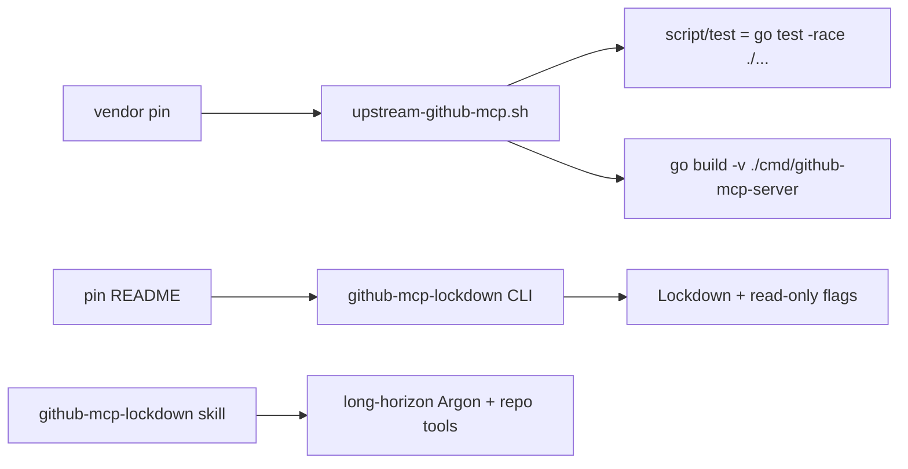

# minilab-github-mcp-lockdown

**Built by SkilledDragon LLC — architecture-led software engineering — [skilleddragon.com](https://skilleddragon.com)**

Palette: `#020617` / `#040F49` / `#006BDF` / `#00BFA6`

Python (uv/pytest) minilab: pin [github/github-mcp-server](https://github.com/github/github-mcp-server), run its keyless Go unit tests and binary build, and document **Lockdown Mode** for long-horizon Gemini 4 Argon flows that need repo tools without soaking untrusted public-repo content.

| Piece | Purpose |
| --- | --- |
| `uv run github-mcp-lockdown` | Parse Lockdown / read-only flags from pin README |
| `scripts/vendor-upstream.sh` | Clone + pin `vendor/github-mcp-server` (gitignored) |
| `scripts/upstream-github-mcp.sh` | Verbatim keyless suite from upstream `go.yml` |
| `scripts/live-mcp-smoke.sh` | Optional live MCP smoke (token required; not CI) |
| `.claude/skills/github-mcp-lockdown/` | Skill: Lockdown Mode for long-horizon Argon |
| CI | Jobs `lab`, `upstream`, `security` |

Upstream pin: [github/github-mcp-server](https://github.com/github/github-mcp-server) @ `c59e8c199efbf14467211861de44afaeeb6873e3` (`main@c59e8c199efb`, MIT)

## What we built and why

GitHub's MCP server exposes repo, issue, and PR tools to agents. Long-horizon Argon sessions that browse public issues and PRs can pull prompt-injection payloads from authors without push access. **Lockdown Mode** filters that content; **read-only** blocks write tools. This lab freezes the server at the pin, re-runs the keyless Go commands from `.github/workflows/go.yml`, and ships a Python parser plus skill so agents enable Lockdown Mode before long runs.



## What we tested

Verified upstream commands at `c59e8c199efbf14467211861de44afaeeb6873e3` (from `.github/workflows/go.yml`). `script/test` is `go test -race ./...`; the lab script raises the package timeout so the race suite can finish on constrained hosts:

```bash
go test -race -timeout 45m ./...
go build -v ./cmd/github-mcp-server
```

Lab keyless suite (no `GITHUB_PERSONAL_ACCESS_TOKEN`):

```bash
export DISABLE_TELEMETRY=1 DO_NOT_TRACK=1
uv sync --locked --group dev
uv run ruff check .
uv run ruff format --check .
uv run pytest -q
python3 scripts/check-skills
python3 scripts/check-banned-phrases
python3 scripts/check-upstream-parity
bash scripts/upstream-github-mcp.sh
```

Pass counts and tool versions: [RESULTS.md](RESULTS.md).

## Setup

Requires Python `>=3.10` (CI uses 3.12), [uv](https://docs.astral.sh/uv/), and Go matching `vendor/github-mcp-server/go.mod` (CI: `actions/setup-go` with `go-version-file`).

```bash
git clone https://github.com/SkilledDragonCorp/minilab-github-mcp-lockdown.git
cd minilab-github-mcp-lockdown
cp .env.example .env
uv sync --locked --group dev
bash scripts/vendor-upstream.sh
```

Confirm the vendor pin:

```bash
git -C vendor/github-mcp-server rev-parse HEAD
# must print c59e8c199efbf14467211861de44afaeeb6873e3
```

Optional pre-commit (gitleaks `v8.30.1`):

```bash
uv run pre-commit install
```

## Tutorial

1. Parse Lockdown Mode flags from the pin README:

```bash
uv run github-mcp-lockdown
uv run github-mcp-lockdown --json
```

2. Run the keyless lab suite (commands in **What we tested**).

3. Build and test upstream at the pin:

```bash
bash scripts/upstream-github-mcp.sh
# asserts bin/github-mcp-server exists
```

4. Optional live smoke (not CI) with a fine-grained PAT:

```bash
# set GITHUB_PERSONAL_ACCESS_TOKEN in .env, then:
set -a && source .env && set +a
bash scripts/live-mcp-smoke.sh
```

## Skills (Claude / Cursor)

Skills live only under `.claude/skills/<name>/SKILL.md`.

| Skill | When to use |
| --- | --- |
| `github-mcp-lockdown` | Enable Lockdown Mode + read-only for long-horizon Argon agents using GitHub MCP repo tools; keep tokens out of prompts |

Do not add `.cursor/skills` or `.agents/skills` mirrors.

## Environment / API keys

| Variable | Required for CI | Purpose |
| --- | --- | --- |
| `DISABLE_TELEMETRY=1` | Yes | Lab telemetry off |
| `DO_NOT_TRACK=1` | Yes | Do-not-track |
| `GITHUB_PERSONAL_ACCESS_TOKEN` | No | Optional live MCP smoke only (`scripts/live-mcp-smoke.sh`) |

See `.env.example`. Never commit `.env`. Never paste tokens into prompts.

## Security

See [SECURITY.md](SECURITY.md). Contact: **hello@skilleddragon.com**.

## License

MIT — see [LICENSE](LICENSE). Upstream `github/github-mcp-server` is MIT at the pin above.
